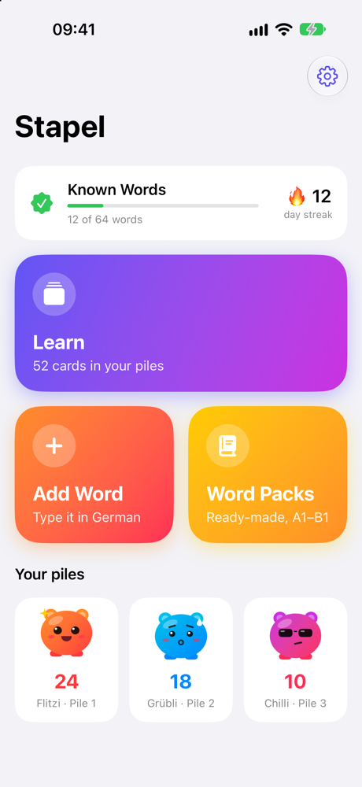
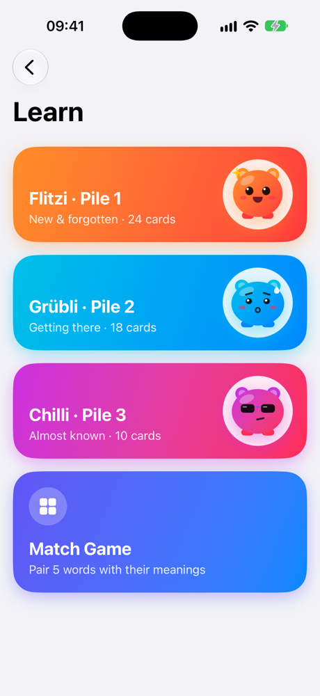
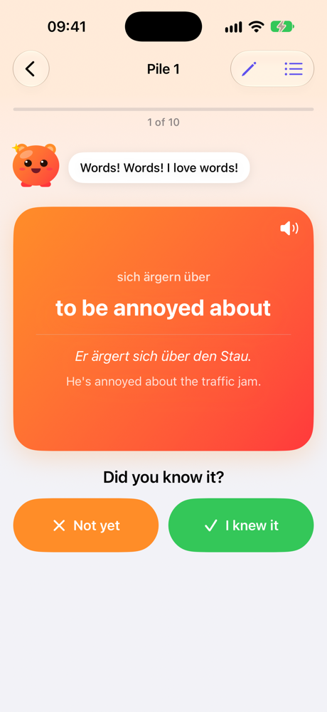
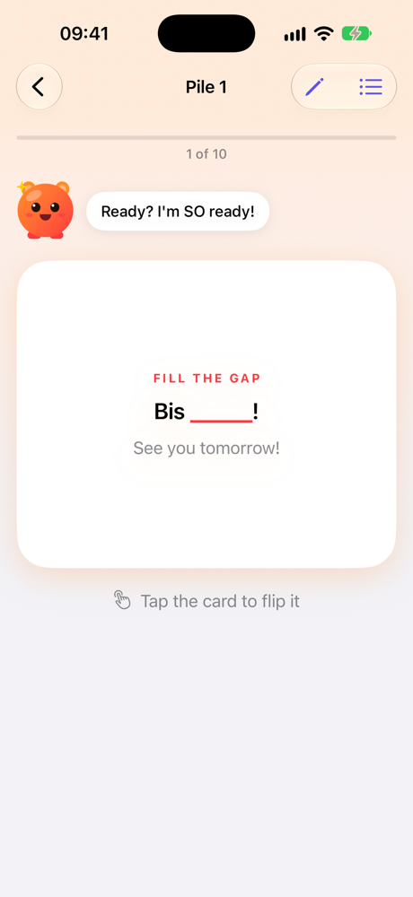
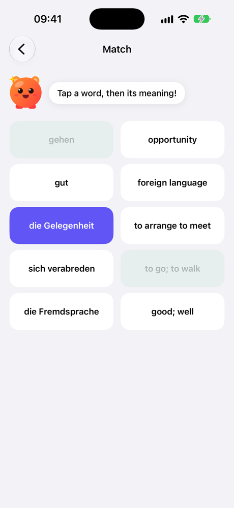
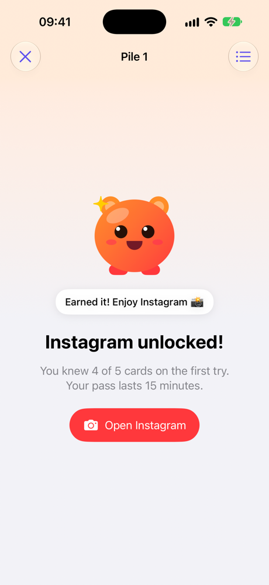

# Stapel

A playful iPhone flashcard app for learning German, built on the 3-pile method. No ads, no account, and your words stay on your phone.

I wanted to stop writing vocabulary in a notebook, and I wanted to learn how to build with an API. I had never made an app before, so I built this one with [Claude Code](https://claude.com/claude-code).

*Stapel* is German for "pile".

| | | |
|:---:|:---:|:---:|
|  |  |  |
|  |  |  |

## How it works

Every word moves through three piles:

```
Pile 1  →  Pile 2  →  Pile 3  →  Known Words
   ↑__________|__________|
     "Not yet" sends a card back to Pile 1
```

Each pile has a plush character who reacts to your answers and sends your reminders:

| Character | Pile | Personality | Reminders |
|---|---|---|---|
| **Flitzi** | 1 | Over-excited | Daily at 10:00, 13:00, 18:00 |
| **Grübli** | 2 | A worrier, sure you've forgotten | Every 2 days at 12:00 |
| **Chilli** | 3 | Too cool to care | Sundays at 14:00 |

## Features

- **Claude fills in your cards.** Type a word, phrase or sentence. Claude fixes the spelling and adds the article, plural, meaning and an example. You can edit everything before saving, or skip Claude and type it yourself.
- **Ready-made word packs.** 300 words and everyday phrases across A1, A2 and B1, added 10 at a time. They work offline and need no API key.
- **Three ways to practice.** Flip cards, fill the gap in a sentence, or play a match game.
- **Missed words come back first.** A missed card returns once at the end of the session and leads the next one.
- **Listen to any card** with the iPhone's built-in voice.
- **Progress at a glance**, with known words and a daily streak.
- **Earn your scrolling (optional).** Make any social app ask for 5 quick cards first, up to 10 with retries. Finish them and you get a 15-minute pass. Every 10th round comes from Pile 2. I use it with Instagram, and the [setup guide](#earn-your-scrolling) is below.

## Run it on your iPhone

You need a Mac, an iPhone on iOS 26 or later, and a free Apple account. No paid developer account is needed.

1. Install **Xcode** from the Mac App Store, including the iOS component it offers on first launch.
2. In Xcode, go to **Settings → Apple Accounts** and sign in with your Apple account.
3. Download this repository (**Code → Download ZIP**) and open `Stapel.xcodeproj`.
4. Select the **Stapel** project, then the **Stapel** target, then **Signing & Capabilities**. Choose your **Team** and change the **Bundle Identifier** to something unique, such as `com.yourname.stapel`.
5. Connect your iPhone with a cable. Turn on **Settings → Privacy & Security → Developer Mode** on the phone.
6. Choose your iPhone at the top of Xcode and press **▶**.
7. The first time, the phone asks you to trust the app: **Settings → General → VPN & Device Management**, then trust your account.

With a free account, the app stops opening after 7 days. Connect the phone and press ▶ again. Your words stay.

> **Planning to publish your own fork?** Copy `Local.xcconfig.example` to `Local.xcconfig` and put your Team ID and bundle identifier there instead of using step 4. Git ignores that file, so they stay out of your repository.

### Earn your scrolling

This uses a Shortcuts automation, which you set up once on your own iPhone. Here's my Instagram setup as an example:

1. In Stapel, go to **Settings → Earn your scrolling** and choose your app.
2. Open the **Shortcuts** app, go to **Automation**, tap **+** and choose **App**.
3. Choose **Instagram** and tick **Is Opened**.
4. Choose **Run Immediately**, then **Next**.
5. Tap **New Blank Automation**, then **Add Action**.
6. Search for **Stapel**, choose **Check App Pass**, then **Done**.

Repeat steps 2 to 6 for each app you want to include. They share one pass. Stapel can reopen Instagram, X, YouTube, Facebook, Snapchat and Reddit for you. These links are unofficial, so they may change. For any other app, choose **Other** and go back to it yourself when the round ends.

If the action doesn't appear, open Stapel once, then fully close and reopen Shortcuts. If you no longer want the rule, turn the automation off in Shortcuts.

### Connect Claude (optional)

Claude only fills in new cards. Everything else works without a key.

Open **Settings → API Key** in the app and follow the steps. In short: create a key in the [Anthropic Console](https://console.anthropic.com), add a little credit, set a low monthly spend limit and paste the key into the app. A Claude chat subscription doesn't include API use.

I estimate about $0.0002 per word with Claude Haiku at current prices. Check your own usage in the Console.

## Make it yours

| To change | Edit |
|---|---|
| The language | `Stapel/Language.swift` and `Stapel/WordPacks.json` (prompt below) |
| Cards per session, which reminders are on | Settings, inside the app |
| Characters and what they say | `Stapel/Mascot.swift` |
| Reminder times | `Stapel/Reminders.swift` |
| Which app to unlock | Settings, inside the app |
| Earn your scrolling: card count, pass length, Pile 2 interval, app links | `Stapel/AppGate.swift` |
| The Claude model and its instructions | `Stapel/CardAssistant.swift` |

### Adapt it to another language

Open this folder in [Claude Code](https://claude.com/claude-code), fill in the two blanks and paste this:

```text
Adapt this Stapel app so I can learn [LANGUAGE TO LEARN]. I speak [MY LANGUAGE].

1. In Stapel/Language.swift, update every value for these languages: names, voice code,
   articles, gap skip words, showsPlural and the three rules for Claude.
2. Replace Stapel/WordPacks.json, keeping the same format, with about 100 entries each for
   A1, A2 and B1. Mix common words with everyday spoken phrases. Each entry is
   [term, plural, meaning, example, example meaning, gap word]. The meanings are in my language.
   The gap word must be copied exactly from the example sentence. Leave the example and gap
   word empty when the entry is already a full sentence.
3. Don't rename fields or change other code, and never add an API key to any file.
4. Check that the JSON is valid and every gap word appears in its example, then build the app
   and tell me what you verified.
```

The on-screen text stays in English. Have someone who knows the language review the word list, because it's AI-generated.

*How far this is tested:* I built and ran the app with a small hand-written Spanish list and studied from it. I haven't yet run the full prompt from scratch or tested Claude's card filling in another language.

## Security and privacy

- **This repository contains no API key.** Everyone uses their own.
- **Your key stays on your iPhone**, in the encrypted Keychain. It isn't in the code, and it doesn't move to other devices through backups.
- **Your words stay on your iPhone.** There's no account, server, analytics or ads.
- **Only one thing leaves the phone:** the text you submit with "Check & fill in", sent directly to Anthropic with your key. Testing a key sends one sample word.

If you ever expose a key, delete it in the Anthropic Console right away. Removing it from a file isn't enough.

This design suits a personal app. Don't ship an app with an API key built in. For an App Store release, you'd need a small server that holds the key.

## What I learned

- **Apple's on-device AI wasn't enough here.** It's free and private, so I tried it first. In a small informal test on my Mac, it got the German article right for only 13 of 20 nouns and never answered "das". On my iPhone it also kept reporting Apple Intelligence as disabled, even though it was on. A wrong article is a bad thing to memorize, so I switched to Claude Haiku.
- **A chat subscription isn't API access.** They're separate products, billed separately.
- **Secrets need a home from day one.** The key went into the Keychain from the start, and signing details moved to a file git ignores.
- **"Crashes" can be freezes.** A toolbar button froze the app at 100% CPU, and iOS then closed it. Reproducing it on the simulator showed this, and opening that screen as a sheet fixed it.
- **Grammar breaks simple ideas.** Blanking out "gehen" fails when the sentence says "Ich gehe". Each card now stores the exact form used in its sentence.
- **Real data deserves caution.** Before I renamed stored fields, I backed up my phone's cards. Afterwards I compared them, and all 192 matched.
- **Real use beats planning.** A week of using it changed the design: shorter sessions, missed words first, and more game modes.

## Project layout

```
Stapel/
├── Language.swift       Everything language-specific
├── Card.swift           The card model and pile rules
├── CardAssistant.swift  Talking to Claude, plus Keychain storage
├── StudyView.swift      Flashcards and fill-the-gap sessions
├── MatchView.swift      The match game
├── Mascot.swift         The characters and their lines
├── Reminders.swift      Local notifications
├── AppGate.swift        Earn your scrolling
└── WordPacks.json       The ready-made word lists
```

It uses Swift, SwiftUI and SwiftData, with no third-party libraries.

## Feedback

Found a bug or a wrong word? Please [open an issue](../../issues). Don't post API keys or other private details in an issue.

## Notes

This is a personal learning project, not an App Store app. The word lists were written with AI help and may contain mistakes, and you can fix any card in the app. Stapel isn't affiliated with Instagram, Apple or Anthropic.

Released under the [MIT License](LICENSE).
